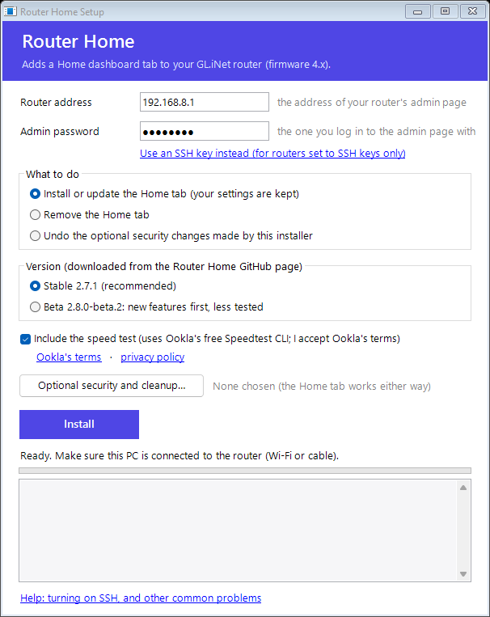
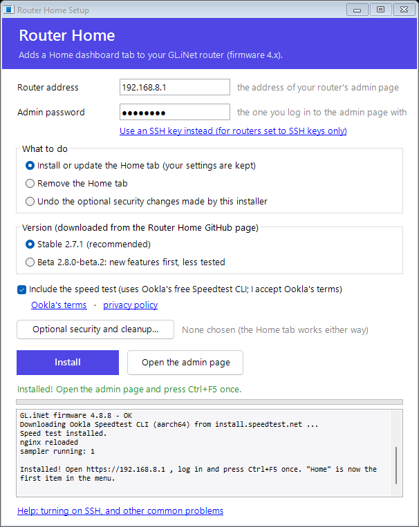
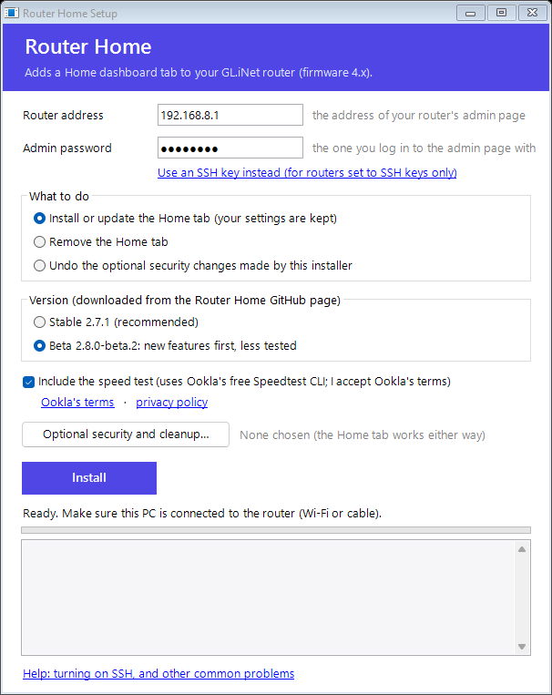
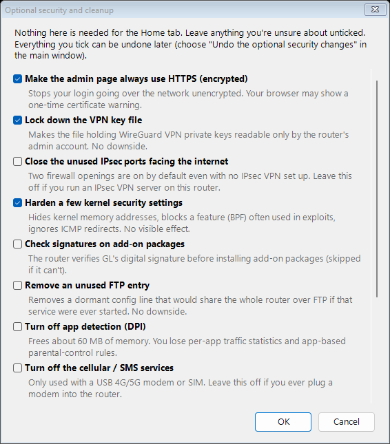

# Router Home Setup (Windows)

The easiest way to put Router Home on a GL.iNet router: **one file, a normal Windows window, no commands to type.**

**[Download Router-Home-Setup.exe](Router-Home-Setup.exe)** (on the next page, click the download button ⤓), then double-click it.

## How to use it

1. **Connect your PC to the router** (Wi-Fi or cable).
2. **Run `Router-Home-Setup.exe`.** The router's address is filled in for you.
3. **Type the router's admin password**, the one you use for its admin page.
4. **Choose a version:** **Stable** (recommended) or **Beta** to try new features early.
5. Press **Install**. It takes about 30 seconds.
6. Open the router's admin page and press **Ctrl+F5** once. **Home** is now the first item in the menu.

## Good to know

- **It doesn't modify GL.iNet's firmware.** Router Home is an app installed on top: it only adds its own files (and a Home entry in GL's menu), replaces none of GL's, and **Remove** takes it all away again.
- **One small file (about 100 KB), always the latest version.** When you press Install, it downloads Router Home (stable or beta) straight from this GitHub page's releases. Before anything is installed, **the router checks the download's digital signature** with the Router Home release key, so a damaged or fake download is refused. No zip to extract, nothing to install on your PC. Works on Windows 10 and 11, and needs internet on the PC.
- **Open source.** The installer's code is in the [Source code](../Source%20code/GUI%20Installer) folder.
- **Antivirus:** scanned on VirusTotal on November 25, 2026: 1 detection out of about 60 engines, from a smaller engine. Malwarebytes and every other engine find nothing. (Malwarebytes flagged an earlier build because of its icon; that's fixed.) Details and report links: [Antivirus scans](../README.md#antivirus-scans-virustotal).
- **SSH must be on in the router** (the installer uses it). If it can't connect, the installer tells you where to turn it on: *Security → Access Control → Enable SSH*.
- **"Windows protected your PC"?** This free installer isn't code-signed, so Windows asks once. Click **More info → Run anyway**.
- **Your password stays on your PC.** It goes straight to Windows' own SSH program for this one connection and is never saved.
- **Beta** installs the newest test version and switches the router's update channel to Beta, so the Home tab's update button offers newer betas. Install Stable again to go back.
- **Optional security and cleanup:** extra hardening you can tick one by one. Nothing here is needed, and everything can be undone later from the same window.
- **Remove** and **Undo the optional security changes** are in the same window.
- **SSH keys only?** If your router only accepts SSH keys, click **Use an SSH key instead** and pick your key file.

> [!WARNING]
> **Made with AI, use at your own risk.** Router Home and this installer were written with the help of AI (Anthropic's Claude). It's a free hobby project, not made or supported by GL.iNet, provided "as is" with **no liability for any problems** it may cause. See the [Disclaimer](../README.md#disclaimer).

Mac users and anyone who prefers scripts: see the [main README](../README.md#install).
Found a problem? [Report it](../README.md#found-a-bug-or-an-issue).
