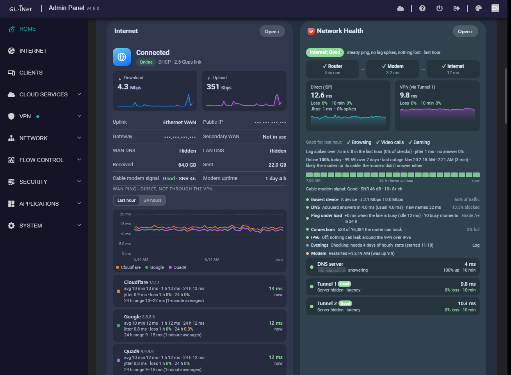
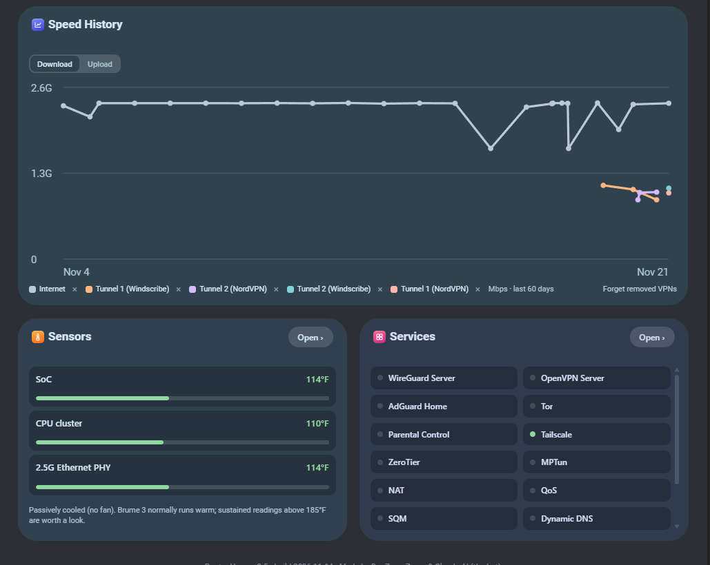

# Router Home

**A Home tab dashboard, monitoring and auto-repair add-on for GL.iNet routers.**

Router Home adds a **Home** tab as the first page of your GL.iNet router's admin panel: a clean dashboard that shows your network's health at a glance, plus background monitoring that spots problems and fixes many of them by itself.

See the [Screenshots](#screenshots) at the bottom of this page.

> [!NOTE]
> **Router Home doesn't modify GL.iNet's firmware.** It's an app installed on top of it, like an add-on: it adds its own files (all named `machome`) next to GL's and a **Home** entry to GL's menu, and replaces none of GL's files. GL's firmware, admin pages and settings stay exactly as they are, and **Remove** takes it all away again. See [What it changes](#what-it-changes).

> [!WARNING]
> **Made with AI, use at your own risk.** Router Home was written with the help of AI (Anthropic's Claude). It is a free hobby project, not made, endorsed or supported by GL.iNet. It changes files and settings on your router, and **no liability is accepted for any problems, data loss, downtime or damage** that may result. Please read the [Disclaimer](#disclaimer) before installing.

## Is it safe? Quick answers

| Question | Answer |
|---|---|
| **Does it change GL.iNet's firmware?** | No. It's an add-on that only adds its own files. GL's firmware, pages and settings stay as they are. [What it changes](#what-it-changes) |
| **Can I see the code?** | Yes, all of it. The router code is in [payload](payload), and the Windows programs are in [Source code](Source%20code). Nothing is hidden or obfuscated. |
| **Does it send my data anywhere?** | Nothing is ever sent to the author: no tracking, no analytics, no accounts. The router only contacts the services its features need (weather, update checks, your own Discord alerts). [Privacy](#privacy-what-it-connects-to) |
| **Can updates be faked?** | No. Every release is digitally signed, and the router refuses anything whose signature doesn't match. [Update or remove](#update-or-remove) |
| **What do antivirus scanners say?** | Router Home itself is clean on every engine on VirusTotal. One small engine (VirIT) flags the Windows GUI installer, but no other engine does. [Antivirus scans](#antivirus-scans-virustotal) |
| **Can I remove it?** | Yes, in one step with the installer. It deletes all of its files and puts GL's upgrade keep-list back the way it was. |

## Features

### Dashboard
System load, temperatures (°F or °C), internet status, live download/upload, WAN ping graphs to Cloudflare, Google and Quad9, and the weather. A status bar at the top sums everything up, and alerts appear as banners with Dismiss, Mute and Clear all.

### Network Health
An internet grade, a router → modem → internet check that shows where a problem is, double-NAT and bridge-mode detection, jitter and lag spikes, what the line is good for right now (browsing, calls, gaming), a 24-hour history strip, uptime, and a likely cause for each outage. Plus temperature and traffic over the last 24 hours.

### VPN, VPN Health and Security
- **VPN (WireGuard and OpenVPN):** every tunnel with on/off switches, a server picker and a 7-day reliability score.
- **VPN Health:** a steady ping per tunnel, DNS and web checks through each tunnel, handshake status, drops vs. harmless ping-only blips, a 5-hour deep monitor and a VPN outage log.
- **Automatic failover:** if a tunnel goes down, its devices move to another healthy tunnel within about 30 seconds (never off the VPN) and move back when it recovers.
- **Security:** checks SSH, the firewall, port forwards, UPnP, remote access and more, every minute.
- **Known vulnerabilities** (Security card, 2.6.5+; new-notice alerts 2.6.6+): checks the router against published security problems, with plain rules (no AI):
  - **GL.iNet security notices**, turned into a signed list of checks in [`security/`](security). For example, the [11-20 cloud-management notice](https://www.gl-inet.com/en-gb/blogs/blog/glinet-security-notice-2026-11-20) checks for GL's sign of infection and whether the exploited service is on.
  - **The National Vulnerability Database (NVD):** published CVEs for your exact model, matched to your firmware version.
  - **GL.iNet's news feeds:** a new GL security post that the list doesn't cover yet shows as "New notice, not checked yet", with a Discord alert, the day it's posted.
  - **GL's firmware release notes (2.7.0+):** when a new firmware for your model describes security fixes, you get "Firmware update needed" with the CVEs. This works for any model.
  - **A daily tampering check (2.7.0+):** signs of a break-in that need no published notice, such as programs running from temp folders, extra admin accounts, or new SSH keys and open ports. Serious findings show **"Factory reset recommended"**.
  - **Optional automation** (off by default): apply safe fixes automatically, and install GL's security firmware at 4 AM.

  It shows Not affected / Exposed / Signs of infection / Firmware update needed, offers a one-click fix where one is safe, and sends a Discord alert for new findings. Firmware upgrades are never automatic. How it works, and why the list is signed: [security/README.md](security/README.md).

### AdGuard, blocked ads and data use
AdGuard Home status (on the router or a NAS), top blocked sites, which devices get the most ads blocked, and internet use for your billing month with a per-day chart and an optional data cap.

### Clients and top devices
Everyone on the network with live speeds, new-device alerts, block/unblock, and the devices using the most data over 24 hours and 7 days.

### Speed tests and history
Ookla speed tests for the internet and each VPN tunnel (one tunnel or all of them), an ISP report card, a VPN/DNS leak test, 60 days of speed history and hardware sensors.

### Access point mode
On a router used as an access point, the Home tab shows an Access Point card with the main router, internet latency and the Wi-Fi clients connected to it.

### GL.inet Utilities Toolkit
Point-and-click tools inspired by [phantasm22](https://github.com/phantasm22)'s [GL.iNet Utilities Toolkit](https://github.com/phantasm22/GL-iNet_utils), rebuilt from scratch for the Home tab: hardware and VPN crypto acceleration details, benchmarks (CPU thermal stress, VPN & crypto speed, storage, memory, DNS latency), an MTU check for WireGuard tunnels (tests a new size for a minute and undoes it by itself if it breaks), per-device speed limits (GL's own limiter), zram tuning (reinstalled automatically after a firmware upgrade), a package system check, and SSH key management.

### Also included
- **Discord alerts:** outages, high ping, VPN drops, new devices, firmware updates and more, with mute, daily digest and anti-spam controls.
- **Auto-heal:** restarts stuck VPN tunnels and services whose memory keeps growing, reconnects when a VPN server comes back, and (opt-in) restarts the cable modem as a last resort. Each repair can be switched off.
- **Logs for support tickets:** an ISP outage and lag log and a VPN outage log, ready to copy or send to Discord.
- **Phone view, DNS hub, scheduled NAS backups, light and dark themes.**

Every feature is explained in [FEATURE GUIDE.txt](FEATURE%20GUIDE.txt). What changed in each version is in [CHANGELOG.txt](CHANGELOG.txt).

## Requirements

- A GL.iNet router on **firmware 4.x**. Tested on the Brume 3 (GL-MT5000), Flint 3 (GL-BE9300) and Slate 7 Pro (GL-BE10000); other 4.x models will probably work (see **Which routers?** below). The installer detects the model and stops safely on other firmware.
- A **Windows 10/11 PC or a Mac** connected to the router.
- The router's **IP address** (often `192.168.8.1`) and its **admin password**.
- **SSH turned on** in the router, because the installer uses it. Check before you start: in the router's admin page, go to **Security → Access Control** (or **Admin Panel**), turn on **Enable SSH**, and click **Apply**. If it won't stay on, set a stronger admin password first: GL turns SSH off when the admin password is weak. With SSH off, the installer says it can't reach the router.

### Which routers?

Only three models have been tested, but nothing is built for one model: the Home tab reads what each router has (ports, Wi-Fi radios, sensors, VPN tunnels) and shows that. The Brume 3 gets its own build; every other model gets the same general build the Flint and Slate run.

| | Models | What to expect |
|---|---|---|
| **Tested** | Brume 3 (GL-MT5000), Flint 3 (GL-BE9300), Slate 7 Pro (GL-BE10000) | Everything works. |
| **Installed by users** | Slate 7 (GL-BE3600, firmware 4.11.0), Beryl 7 | Users report a successful install. Thanks for the reports! |
| **Very likely works** | Recent GL.iNet routers on firmware 4.x, e.g. Flint 2, Brume 2, Beryl AX, Slate AX, Spitz AX, Marble, Puli AX | Same admin system and tools as the tested models. |
| **Works, with less** | Older or budget models with 4.x firmware (e.g. Mango, Shadow, Opal, older Beryl) | No speed test (Ookla only makes it for ARM and x86 chips; the installer skips it). Needs about 1.3 MB of free storage, so routers with 16 MB of flash or 128 MB of RAM may be too tight. Slower chips feel the background checks more. |
| **Won't install** | Firmware 3.x or older, or plain OpenWrt without GL's firmware | The installer checks first and stops without changing anything. |

- **Hardware-specific features only appear when the router has the hardware:** fan control, the touchscreen weather (Slate 7 Pro), hardware crypto details, Wi-Fi details. Temperature sensors the Home tab doesn't recognize show their raw names.
- **Toolkit extras:** speed limits use GL's own limiter (most 4.x models have it); the MTU tool needs WireGuard tunnels.
- **Firmware versions matter more than models.** Tested on firmware 4.9 and 4.10; users have installed it on 4.11. On a much older 4.x, a card might show no data if GL changed something internally. The page still loads, and **Remove** (option 2 in the installer) undoes everything.
- **Tried it on another model?** Let me know how it went (see [Found a bug or an issue?](#found-a-bug-or-an-issue)), with your model and firmware version, and a screenshot if something looks off.

## Just want a security check?

The **[Vulnerability Checker](Vulnerability%20Checker)** is a separate, free Windows program. It checks any GL.iNet router once against GL's published security notices and the published signs of an attack, then tells you in plain words what to do. You don't need Router Home, nothing is installed on the router, and it's one file to double-click.

## Install

**Windows, easiest:** open the **[GUI Installer](GUI%20Installer)** folder above, click **`Router-Home-Setup.exe`**, then the download button (⤓), and double-click the file. Type the router's admin password, choose **Stable** (or **Beta** to try new features early), and press **Install**. The router's address is filled in for you. The installer downloads the latest release from this page, and the router checks its signature before installing anything. Windows may say *"Windows protected your PC"* because this free installer isn't code-signed: click **More info → Run anyway**. Remove and Undo are in the same window.

Or use the scripts: download the latest release zip and extract it first. Don't run it from inside the zip.

**Windows (script)**
1. Double-click `Install Router Home.cmd`.
2. Choose **1**, enter the router's IP, and answer the speed-test question.
3. Type the admin password when asked (just once). Nothing shows while you type.
4. Open the router's admin page and press **Ctrl+F5**. **Home** is now at the top of the menu.

**Mac**
1. Open Terminal (Applications → Utilities → Terminal).
2. Type `sh ` (with a space), drag `Install Router Home (Mac).command` into the window, and press Return.
3. Follow the same steps as on Windows, then reload the admin page with **Cmd+Shift+R**.

Full details, including the optional security settings the installer offers, are in [READ ME FIRST.txt](READ%20ME%20FIRST.txt).

## Antivirus scans (VirusTotal)

Everything on this page was scanned on [VirusTotal](https://www.virustotal.com), which checks files with about 60 antivirus engines (last scan: November 25, 2026):

| What was scanned | Result |
|---|---|
| **Router Home itself**: the release files (v2.7.1 installer zip and signed update package), which hold the code that runs on your router | [**Clean on every engine**](https://www.virustotal.com/gui/file/3301eebbf2cee58e76e80ca0baba511e9860e9d742270ef3f6ed89a8902da0ab/detection) |
| **The repo files**: everything on this page, including the Windows programs (GUI Installer and Vulnerability Checker) | [**1 detection** out of about 60 engines](https://www.virustotal.com/gui/file/0bf84e988f77d7370767c2ccbb20f93b9fd90d1ed1b2ff8b66c07391c2f013d9/detection), from **VirIT**, on the **GUI Installer** (`Router-Home-Setup.exe`). Malwarebytes and every other engine: clean. |

**About that one detection:** it's only the **Windows GUI installer**, the small program that copies Router Home to your router. **Router Home itself, the code that runs on the router, isn't flagged by any engine.** VirIT is a smaller Italian antivirus engine. New programs that aren't code-signed and haven't been downloaded much yet are often flagged by one or two smaller engines' "looks unusual" rules, even when they're harmless, which is common for free open-source tools. If you'd rather not use the GUI installer, the [script installers](#install) do the same job without any program at all.

**Fixed along the way:** an earlier build of `Router-Home-Setup.exe` was flagged by Malwarebytes' machine-learning rule ("MachineLearning/Anomalous", a guess based on how a file looks, not a known-malware match). Testing showed the trigger was the program's custom icon. The current installer ships without it and passes Malwarebytes cleanly. The installer also no longer carries Router Home inside it: it downloads the signed release when you press Install.

You don't have to take our word for any of this: **all of the code is public** in the [Source code](Source%20code) and [payload](payload) folders, so you (or anyone you trust) can read it, or build the programs yourself.

## What it changes

- **It doesn't modify GL.iNet's firmware.** The firmware itself (the system image GL installs) is never touched or replaced, and you can keep installing GL's firmware updates as normal. Router Home is an app that runs on top of it.
- **It only adds files.** It adds about 28 of its own files, all with `machome` in their name or folder (the Home page, its menu entry, the background service that collects the statistics, and its settings in `/etc/machome`). None of GL's own files are replaced. The only GL file it touches is the upgrade keep-list (`/etc/sysupgrade.conf`), where it adds its own file names so they survive firmware upgrades with "Keep settings" on. **Remove** deletes all of its files and takes those lines out again.
- It does **not** change Wi-Fi, firewall, VPN, DNS or passwords. Optional security tweaks are only applied if you say yes to each one, and each can be undone.
- If any of its files already exist (an older Router Home), they're backed up to `/root/machome-backup/` first.
- Your password goes straight into your computer's own SSH program; the installer never sees or saves it.
- Speed tests use Ookla's Speedtest CLI, which isn't included here. If you say yes, the router downloads it directly from Ookla.

## Privacy: what it connects to

**Nothing is ever sent to the author.** Router Home has no tracking, no analytics, no accounts and no "phone home". Everything it collects (speeds, devices, history) stays on your router. The router only contacts these services, each for a feature you can see:

| Service | Why |
|---|---|
| Cloudflare, Google, Quad9, Apple, `neverssl.com` | Internet, ping and DNS checks (is the internet up, how fast it answers) |
| Open-Meteo, Iowa State University (radar), Ventusky | Weather, the forecast and the radar map |
| GitHub (this page) | Checking for Router Home updates and the signed vulnerability list |
| US National Vulnerability Database (`nvd.nist.gov`), GL.iNet's website | Known vulnerabilities for your model, and GL's security news |
| Ookla | Speed tests (only if you turned them on) |
| Discord (and in 2.8.0 Telegram, Gmail, Slack or Home Assistant) | Your own alerts, sent only to the accounts you set up |

Your passwords and alert settings are stored on the router only, readable by the router's admin account alone.

## Update or remove

- **From the Home tab (version 2.6 and later):** Control Center → **Router Home updates** → **Check**. It downloads the latest release from this page, checks its signature, and installs it in about a minute. Your settings are kept, and if anything goes wrong the previous version is put back automatically.
- **With the installer:** run it again and choose **1** to update (your settings are kept), **2** to remove Router Home, or **3** to undo the optional security changes.

**Want new features early?** From 2.7.1, Control Center → **Router Home updates** → Update channel → **Beta** also offers test versions (marked *Pre-release* on the [Releases](../../releases) page). They're less tested, so please [report anything odd](#found-a-bug-or-an-issue). Switch back to **Stable** any time.

Updates are signed: the Home tab only installs packages signed with the Router Home release key, so a tampered download is refused. From 2.6.4 the router also checks once a day by itself and sends a Discord message when a new version is out (it never installs on its own).

## Found a bug or an issue?

Report it to me on **[Discord](https://discord.com/users/861741061465571349)**. It helps to include:

- your router model and firmware version (GL admin page → System → Overview)
- your Router Home version (the line at the very bottom of the Home tab)
- what happened, and a screenshot if something looks wrong. Turn on **privacy mode** first (the eye icon in the top bar) so your IP and MAC addresses and device names are hidden.

## Disclaimer

- **AI-assisted:** most of Router Home's code, installers and documents were written with the help of AI (Anthropic's Claude) and then tested on the author's own GL.iNet routers. AI-written code can contain mistakes that testing didn't catch.
- **No warranty, no liability:** Router Home is provided **"as is"**, without warranty of any kind. By installing it you accept all risk. The author is not liable for any problem it may cause, including lost settings or data, network or internet downtime, security issues, a router that needs a reset or recovery, or any other damage. See the [MIT License](LICENSE).
- **Not official:** Router Home is not made, endorsed or supported by GL.iNet. GL.iNet's support may ask you to remove it before helping you.
- **Before installing:** back up your router's settings from the GL admin page (the Backup / Restore option under System). If something goes wrong, **Remove** Router Home with the installer, or reset the router.

## License

[MIT](LICENSE)

## Screenshots

**Dashboard:** status bar, weather and the System card

**Internet and Network Health**

**Last 24 Hours, VPN and VPN Health**

**Security, AdGuard Home, Ads Blocked by Device and Data This Month**

**Clients, Top Devices and Speed Test**

**Speed History, Sensors and Services**

**Access point mode**

