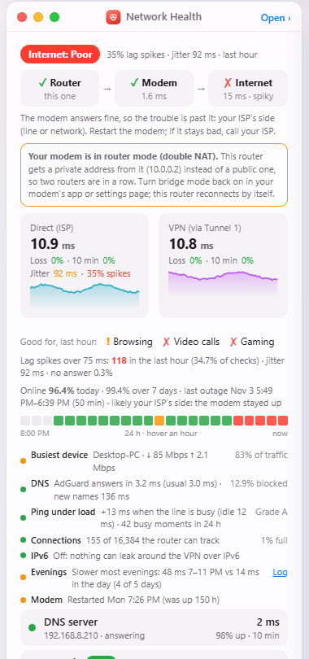
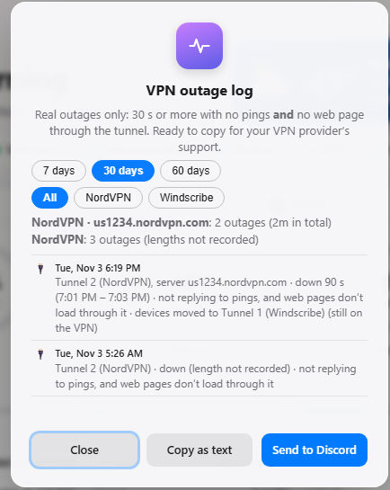
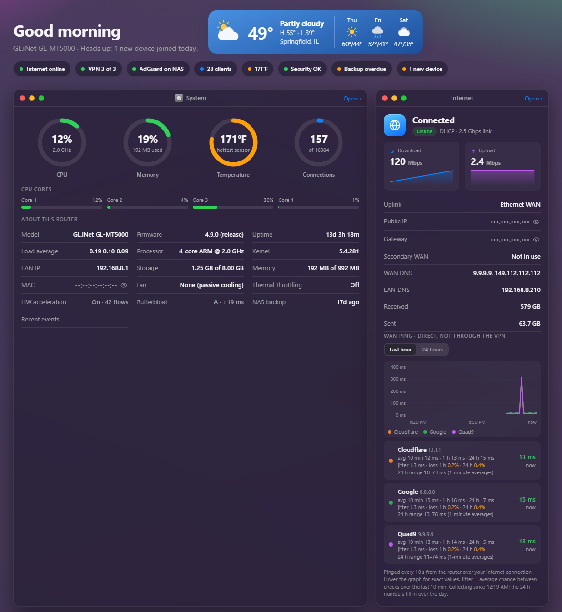

# Router Home

**A Home tab dashboard, monitoring and auto-repair add-on for GL.iNet routers.**

Router Home adds a **Home** tab as the first page of your GL.iNet router's admin panel: a clean dashboard that shows your network's health at a glance, plus background monitoring that spots problems and fixes many of them by itself.

  
  

## Features

- **Dashboard:** internet status, WAN ping graphs, speed tests, connected devices, top bandwidth users, Wi-Fi, system health and weather (°F).
- **VPN monitoring (WireGuard and OpenVPN):** a steady ping per tunnel, DNS and web checks through each tunnel, ping-only blip detection, a 7-day reliability score and a 5-hour deep monitor.
- **Automatic VPN failover:** if a tunnel goes down, its devices move to another healthy tunnel within about 30 seconds (never off the VPN) and move back when it recovers.
- **Network Health:** an internet grade, router → modem → internet diagnosis, double-NAT and bridge-mode detection, jitter and lag spikes, a 24-hour history strip and a likely cause for each outage.
- **Logs for support tickets:** an ISP outage and lag log and a VPN outage log, ready to copy or send to Discord.
- **Discord alerts:** outages, high ping, VPN drops, new devices, firmware updates and more, with mute, daily digest and anti-spam controls.
- **Auto-heal:** restarts stuck VPN tunnels and services whose memory keeps growing, reconnects when a VPN server comes back, and (opt-in) restarts the cable modem as a last resort. Each repair can be switched off.
- **Security panel:** checks SSH, the firewall, port forwards, UPnP and remote access.
- **Also:** a phone view, a DNS hub, scheduled NAS backups, and light and dark themes.

Every feature is explained in [FEATURE GUIDE.txt](FEATURE%20GUIDE.txt). What changed in each version is in [CHANGELOG.txt](CHANGELOG.txt).

## Requirements

- A GL.iNet router on **firmware 4.x**. Tested on the Brume 3 (GL-MT5000), Flint 3 (GL-BE9300) and Slate 7 Pro (GL-BE10000); other 4.x models will probably work. The installer detects the model and stops safely on other firmware.
- A **Windows 10/11 PC or a Mac** connected to the router.
- The router's **IP address** (often `192.168.8.1`) and its **admin password**.

## Install

Download the latest release zip and extract it first. Don't run it from inside the zip.

**Windows**
1. Double-click `Install Router Home.cmd`.
2. Choose **1**, enter the router's IP, and answer the speed-test question.
3. Type the admin password when asked. You're asked twice, and nothing shows while you type.
4. Open the router's admin page and press **Ctrl+F5**. **Home** is now at the top of the menu.

**Mac**
1. Open Terminal (Applications → Utilities → Terminal).
2. Type `sh ` (with a space), drag `Install Router Home (Mac).command` into the window, and press Return.
3. Follow the same steps as on Windows, then reload the admin page with **Cmd+Shift+R**.

Full details, including the optional security settings the installer offers, are in [READ ME FIRST.txt](READ%20ME%20FIRST.txt).

## What it changes

- It adds the Home tab files and a small background service that collects the statistics.
- It does **not** change Wi-Fi, firewall, VPN, DNS or passwords. Optional security tweaks are only applied if you say yes to each one.
- Everything it replaces is backed up to `/root/machome-backup/` on the router, and it survives firmware upgrades when "Keep settings" is selected.
- Your password goes straight into your computer's own SSH program; the installer never sees or saves it.
- Speed tests use Ookla's Speedtest CLI, which isn't included here. If you say yes, the router downloads it directly from Ookla.

## Update or remove

Run the installer again and choose **1** to update (your settings are kept), **2** to remove Router Home, or **3** to undo the optional security changes.

## License

[MIT](LICENSE)
