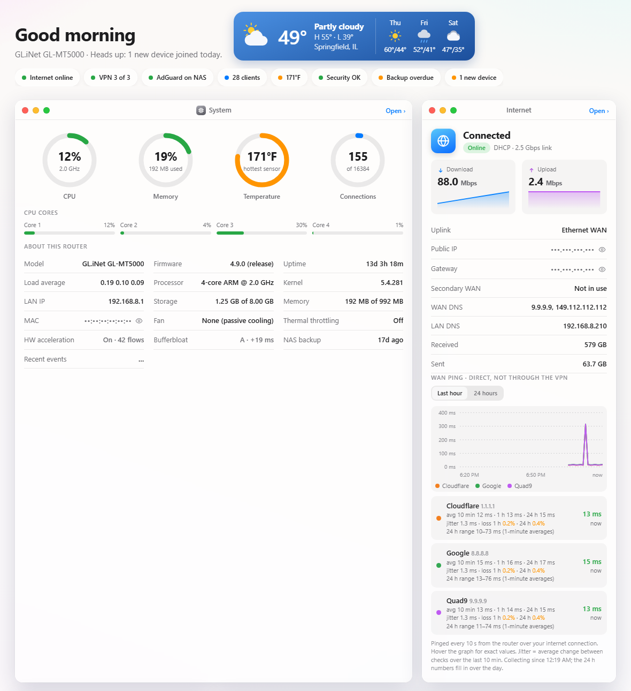
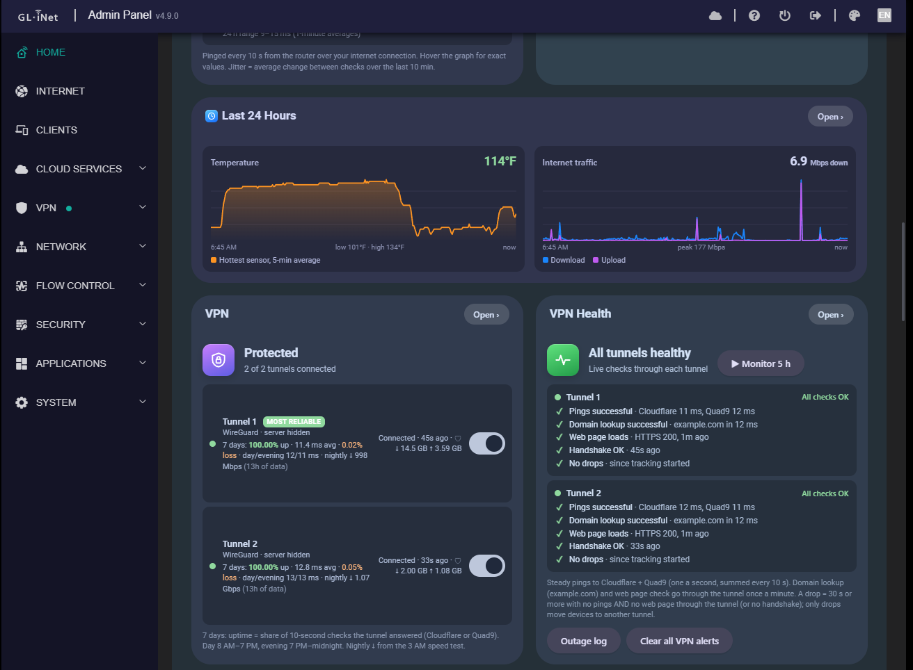
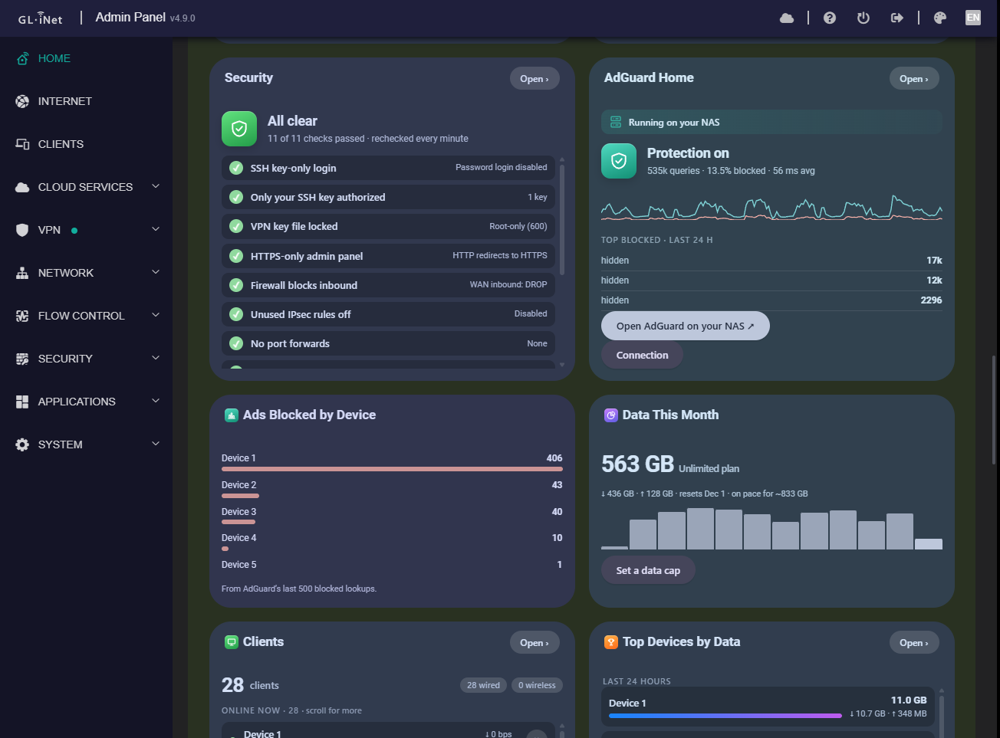
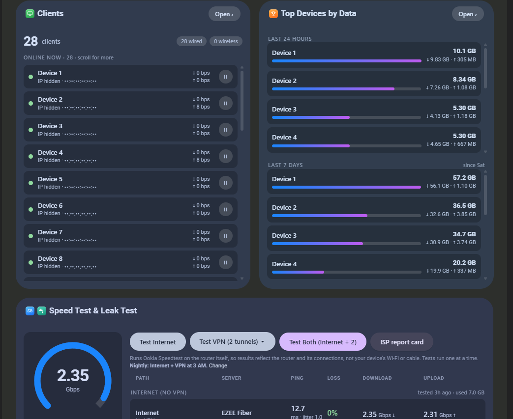
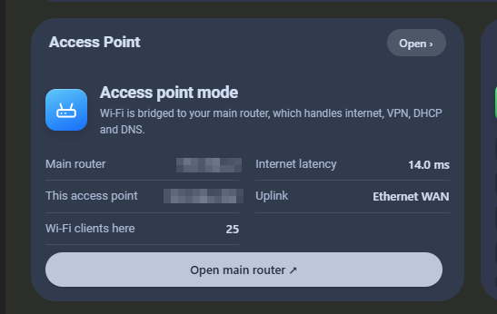

# Router Home

**A Home tab dashboard, monitoring and auto-repair add-on for GL.iNet routers.**

Router Home adds a **Home** tab as the first page of your GL.iNet router's admin panel: a clean dashboard that shows your network's health at a glance, plus background monitoring that spots problems and fixes many of them by itself.

See the [Screenshots](#screenshots) at the bottom of this page.

## Features

### Dashboard
System load, temperatures (°F), internet status, live download/upload, WAN ping graphs to Cloudflare, Google and Quad9, and the weather. A status bar at the top sums everything up, and alerts appear as banners with Dismiss, Mute and Clear all.

### Network Health
An internet grade, a router → modem → internet check that shows where a problem is, double-NAT and bridge-mode detection, jitter and lag spikes, what the line is good for right now (browsing, calls, gaming), a 24-hour history strip, uptime, and a likely cause for each outage. Plus temperature and traffic over the last 24 hours.

### VPN, VPN Health and Security
- **VPN (WireGuard and OpenVPN):** every tunnel with on/off switches, a server picker and a 7-day reliability score.
- **VPN Health:** a steady ping per tunnel, DNS and web checks through each tunnel, handshake status, drops vs. harmless ping-only blips, a 5-hour deep monitor and a VPN outage log.
- **Automatic failover:** if a tunnel goes down, its devices move to another healthy tunnel within about 30 seconds (never off the VPN) and move back when it recovers.
- **Security:** checks SSH, the firewall, port forwards, UPnP, remote access and more, every minute.
- **Known vulnerabilities** (Security card, 2.6.5+; new-notice alerts 2.6.6+): checks the router against published security problems, with plain rules (no AI):
  - **GL.iNet security notices**, turned into a signed list of checks in [`security/`](security). For example, the [11-20 cloud-management notice](https://www.gl-inet.com/en-gb/blogs/blog/glinet-security-notice-2026-11-20) checks for GL's sign of infection and whether the exploited service is on.
  - **The National Vulnerability Database (NVD):** published CVEs for your exact model, matched to your firmware version.
  - **GL.iNet's news feeds:** a new GL security post that the list doesn't cover yet shows as "New notice, not checked yet", with a Discord alert, the day it's posted.

  It shows Not affected / Exposed / Signs of infection / Firmware update needed, offers a one-click fix where one is safe, and sends a Discord alert for new findings. Firmware upgrades are never automatic. How it works, and why the list is signed: [security/README.md](security/README.md).

### AdGuard, blocked ads and data use
AdGuard Home status (on the router or a NAS), top blocked sites, which devices get the most ads blocked, and internet use for your billing month with a per-day chart and an optional data cap.

### Clients and top devices
Everyone on the network with live speeds, new-device alerts, block/unblock, and the devices using the most data over 24 hours and 7 days.

### Speed tests and history
Ookla speed tests for the internet and each VPN tunnel (one tunnel or all of them), an ISP report card, a VPN/DNS leak test, 60 days of speed history and hardware sensors.

### Access point mode
On a router used as an access point, the Home tab shows an Access Point card with the main router, internet latency and the Wi-Fi clients connected to it.

### GL.inet Utilities Toolkit
Point-and-click tools inspired by [phantasm22](https://github.com/phantasm22)'s [GL.iNet Utilities Toolkit](https://github.com/phantasm22/GL-iNet_utils), rebuilt from scratch for the Home tab: hardware and VPN crypto acceleration details, benchmarks (CPU thermal stress, VPN & crypto speed, storage, memory, DNS latency), an MTU check for WireGuard tunnels (tests a new size for a minute and undoes it by itself if it breaks), per-device speed limits (GL's own limiter), zram tuning (reinstalled automatically after a firmware upgrade), a package system check, and SSH key management.

### Also included
- **Discord alerts:** outages, high ping, VPN drops, new devices, firmware updates and more, with mute, daily digest and anti-spam controls.
- **Auto-heal:** restarts stuck VPN tunnels and services whose memory keeps growing, reconnects when a VPN server comes back, and (opt-in) restarts the cable modem as a last resort. Each repair can be switched off.
- **Logs for support tickets:** an ISP outage and lag log and a VPN outage log, ready to copy or send to Discord.
- **Phone view, DNS hub, scheduled NAS backups, light and dark themes.**

Every feature is explained in [FEATURE GUIDE.txt](FEATURE%20GUIDE.txt). What changed in each version is in [CHANGELOG.txt](CHANGELOG.txt).

## Requirements

- A GL.iNet router on **firmware 4.x**. Tested on the Brume 3 (GL-MT5000), Flint 3 (GL-BE9300) and Slate 7 Pro (GL-BE10000); other 4.x models will probably work (see **Which routers?** below). The installer detects the model and stops safely on other firmware.
- A **Windows 10/11 PC or a Mac** connected to the router.
- The router's **IP address** (often `192.168.8.1`) and its **admin password**.

### Which routers?

Only three models have been tested, but nothing is built for one model: the Home tab reads what each router has (ports, Wi-Fi radios, sensors, VPN tunnels) and shows that. The Brume 3 gets its own build; every other model gets the same general build the Flint and Slate run.

| | Models | What to expect |
|---|---|---|
| **Tested** | Brume 3 (GL-MT5000), Flint 3 (GL-BE9300), Slate 7 Pro (GL-BE10000) | Everything works. |
| **Very likely works** | Recent GL.iNet routers on firmware 4.x, e.g. Flint 2, Brume 2, Beryl AX, Slate AX, Spitz AX, Marble, Puli AX | Same admin system and tools as the tested models. |
| **Works, with less** | Older or budget models with 4.x firmware (e.g. Mango, Shadow, Opal, older Beryl) | No speed test (Ookla only makes it for ARM and x86 chips; the installer skips it). Needs about 1.3 MB of free storage, so routers with 16 MB of flash or 128 MB of RAM may be too tight. Slower chips feel the background checks more. |
| **Won't install** | Firmware 3.x or older, or plain OpenWrt without GL's firmware | The installer checks first and stops without changing anything. |

- **Hardware-specific features only appear when the router has the hardware:** fan control, the touchscreen weather (Slate 7 Pro), hardware crypto details, Wi-Fi details. Temperature sensors the Home tab doesn't recognize show their raw names.
- **Toolkit extras:** speed limits use GL's own limiter (most 4.x models have it); the MTU tool needs WireGuard tunnels.
- **Firmware versions matter more than models.** Tested on firmware 4.9 and 4.10. On a much older 4.x, a card might show no data if GL changed something internally. The page still loads, and **Remove** (option 2 in the installer) undoes everything.
- **Tried it on another model?** Let me know how it went (see [Found a bug or an issue?](#found-a-bug-or-an-issue)), with your model and firmware version, and a screenshot if something looks off.

## Install

Download the latest release zip and extract it first. Don't run it from inside the zip.

**Windows**
1. Double-click `Install Router Home.cmd`.
2. Choose **1**, enter the router's IP, and answer the speed-test question.
3. Type the admin password when asked (just once). Nothing shows while you type.
4. Open the router's admin page and press **Ctrl+F5**. **Home** is now at the top of the menu.

**Mac**
1. Open Terminal (Applications → Utilities → Terminal).
2. Type `sh ` (with a space), drag `Install Router Home (Mac).command` into the window, and press Return.
3. Follow the same steps as on Windows, then reload the admin page with **Cmd+Shift+R**.

Full details, including the optional security settings the installer offers, are in [READ ME FIRST.txt](READ%20ME%20FIRST.txt).

## What it changes

- It adds the Home tab files and a small background service that collects the statistics.
- It does **not** change Wi-Fi, firewall, VPN, DNS or passwords. Optional security tweaks are only applied if you say yes to each one.
- Everything it replaces is backed up to `/root/machome-backup/` on the router, and it survives firmware upgrades when "Keep settings" is selected.
- Your password goes straight into your computer's own SSH program; the installer never sees or saves it.
- Speed tests use Ookla's Speedtest CLI, which isn't included here. If you say yes, the router downloads it directly from Ookla.

## Update or remove

- **From the Home tab (version 2.6 and later):** Control Center → **Router Home updates** → **Check**. It downloads the latest release from this page, checks its signature, and installs it in about a minute. Your settings are kept, and if anything goes wrong the previous version is put back automatically.
- **With the installer:** run it again and choose **1** to update (your settings are kept), **2** to remove Router Home, or **3** to undo the optional security changes.

Updates are signed: the Home tab only installs packages signed with the Router Home release key, so a tampered download is refused. From 2.6.4 the router also checks once a day by itself and sends a Discord message when a new version is out (it never installs on its own).

## Found a bug or an issue?

Report it to me on **[Discord](https://discord.com/users/861741061465571349)**. It helps to include:

- your router model and firmware version (GL admin page → System → Overview)
- your Router Home version (the line at the very bottom of the Home tab)
- what happened, and a screenshot if something looks wrong. Turn on **privacy mode** first (the eye icon in the top bar) so your IP and MAC addresses and device names are hidden.

## License

[MIT](LICENSE)

## Screenshots

**Dashboard:** status bar, weather and the System card

**Internet and Network Health**

**Last 24 Hours, VPN and VPN Health**

**Security, AdGuard Home, Ads Blocked by Device and Data This Month**

**Clients, Top Devices and Speed Test**

**Speed History, Sensors and Services**

**Access point mode**

