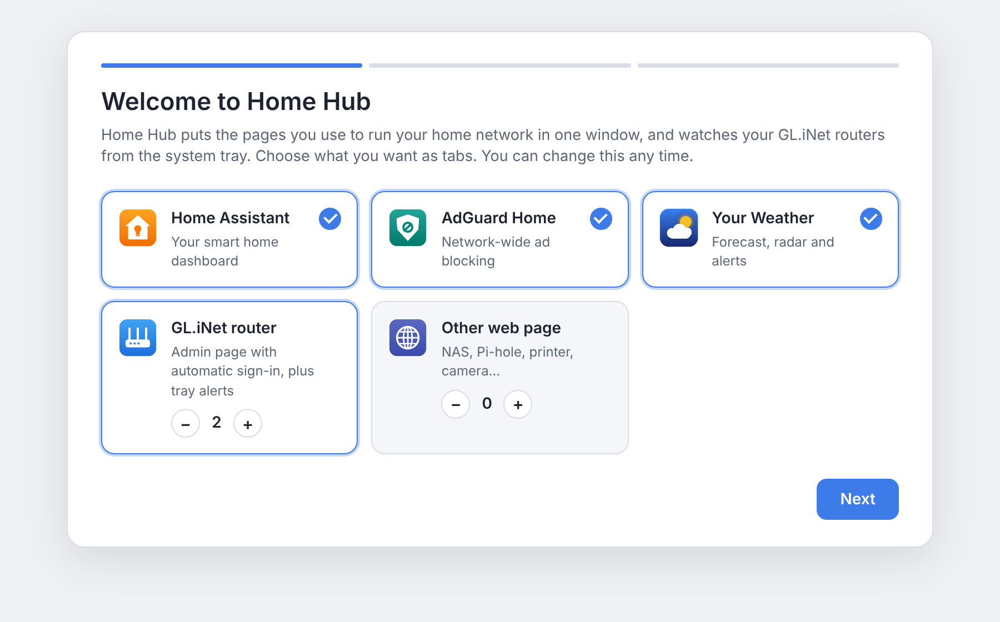
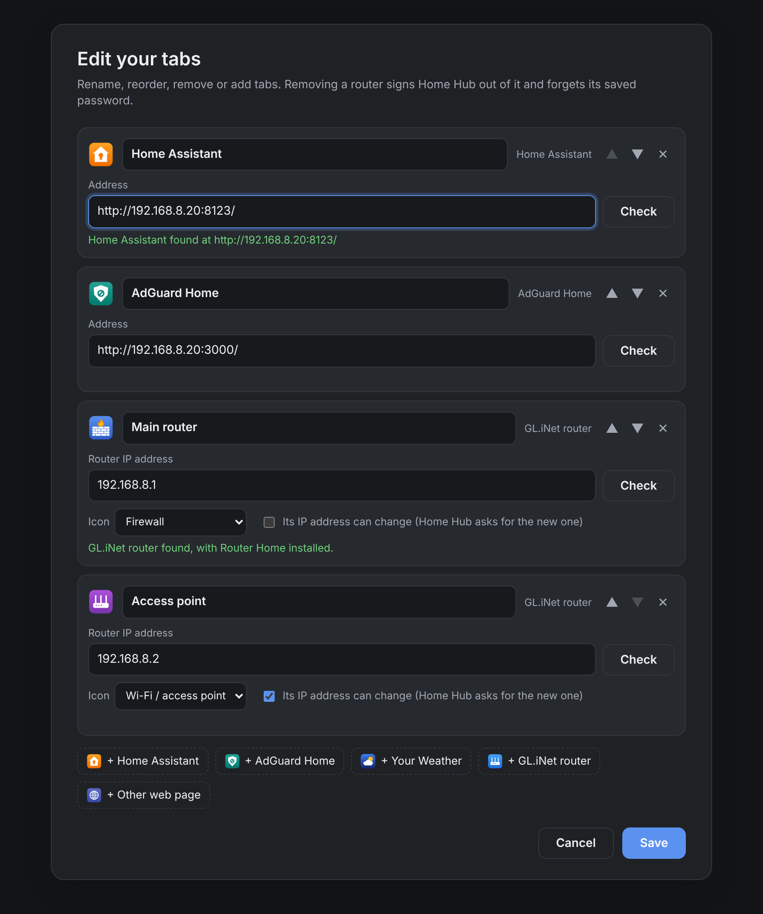

# Home Hub

**Your home network's web pages in one Windows app, with GL.iNet router alerts in the system tray.**

Home Hub puts Home Assistant, AdGuard Home, your GL.iNet routers, a weather dashboard and any other web page you use at home into tabs in one window. You stay signed in to each one, and Home Hub keeps watching your routers in the background, so a problem shows up on your desktop even when the window is closed.

It's built to work with [**Router Home**](https://github.com/xDarkHawkx/RouterHome), the Home tab add-on for GL.iNet routers, and works with any GL.iNet 4.x router without it too.

> [!WARNING]
> **Made with AI, use at your own risk.** Home Hub was written with the help of AI (Anthropic's Claude). It's a free hobby project, not made, endorsed or supported by GL.iNet, Home Assistant or AdGuard. It's provided "as is", and **no liability is accepted for any problems** it may cause. See the [Disclaimer](#disclaimer).



## Features

- **Your tabs, your way.** The first time it opens, Home Hub asks which tabs you want and where each one is. Choose from:

  | Tab | What it does |
  |---|---|
  | **Home Assistant** | Your dashboard in its own window. You sign in once, including two-step verification. |
  | **AdGuard Home** | The AdGuard Home admin page. |
  | **GL.iNet router** (add several) | The router's admin page with **automatic sign-in**. With Router Home installed, it opens straight to the Home tab. |
  | **Your Weather** | A forecast dashboard: radar, alerts, air quality, a week-ahead summary, animated weather scenes and dark mode. |
  | **Other web page** | Anything else on your network: NAS, Pi-hole, printer, cameras. |

  A **Check** button confirms each address answers (and tells you if a router has Router Home). Change, rename, reorder or remove tabs any time with the gear button or **Edit tabs…** in the tray menu.
- **Router alerts on your desktop.** Every 30 seconds Home Hub checks each GL.iNet router and shows a Windows notification when something goes wrong, then again when it's fixed. The tray icon turns green, orange or red, and each router tab has a status dot.
  - **With Router Home:** you get internet and DNS outages, VPN tunnels down, VPN failover, high ping, overheating, failed security checks, known vulnerabilities (exposed, signs of infection, firmware security updates), new devices joining, and new firmware.
  - **Without it:** you're told when the router is unreachable or offline.
- **Secure sign-in for routers.**
  - The router password is kept in **Windows Credential Manager**, encrypted for your Windows account.
  - The router's self-signed certificate is **pinned** by its SHA-256 fingerprint, and you're warned if it ever changes.
  - The session id never goes to your regular browser.
- **Optional PIN lock.** Home Hub can ask for a 4 to 8 digit PIN when it opens, and locks again when you close it to the tray. Router alerts keep working while it's locked. The PIN is stored only as a salted PBKDF2 hash, and wrong guesses are slowed down. "Forgot your PIN?" signs you out of everything before letting you set a new one.
- **Routers whose IP changes.** Tick "Its IP address can change", and Home Hub asks for the new address instead of failing.
- **Small things:**
  - **Ctrl+1…9** switches tabs, **Ctrl+Tab** cycles through them, **F5** reloads, **Ctrl+L** locks.
  - **Start with Windows** starts Home Hub quietly in the tray.
  - Light and dark mode follow Windows.
  - Home Hub checks GitHub once a day for a newer version. It only tells you; it never downloads anything by itself.



## Install

1. Download `HomeHub.exe` from the [latest release](https://github.com/xDarkHawkx/HomeHub/releases/latest).
2. Put it wherever you like (for example `Documents\Home Hub`) and double-click it. There's no installer, and nothing else to download.
3. Choose your tabs, enter their addresses, and pick whether to use a PIN.
4. Open each tab and sign in once.

**Requirements:**

- Windows 10 or 11 (64-bit).
- The Microsoft Edge **WebView2 Runtime**. Windows 11 already has it. On Windows 10 it usually comes with Microsoft Edge; if a tab can't start, [install it from Microsoft](https://developer.microsoft.com/microsoft-edge/webview2/).

**About antivirus warnings:** Home Hub is a new, unsigned program that adds itself to "start with Windows" (only if you ask), reads and writes Windows Credential Manager, and talks to devices on your network. A few antivirus engines flag new programs like that on reputation alone. The full source is here, and the release `.exe` is built from it by GitHub Actions (see the workflow run linked from each release).

## Works best with Router Home

[Router Home](https://github.com/xDarkHawkx/RouterHome) adds a **Home** tab to GL.iNet's admin panel: a dashboard with VPN health, security checks, speed tests and auto-repair. When a router has it:

- the router tab opens on the Home tab instead of GL.iNet's default page
- Home Hub reads Router Home's live status (the same alerts as the Home tab's banner) instead of only checking that the router is online
- the tab's right-click menu shows which Router Home version the router runs

On a router without it, the tab's right-click menu has **Get Router Home for this router…**.

If you already use the **Router Home Windows app**, Home Hub offers that router on first run and reuses its saved password and trusted certificate. Close the Router Home app first: the two share the same browser profile.

## Where things are stored

| What | Where |
|---|---|
| Settings (tabs, window size, PIN hash) | `%APPDATA%\HomeHub\settings.json` |
| Router settings (address, user, certificate fingerprint) | `%APPDATA%\HomeHub\routers\*.json` |
| Router passwords | Windows Credential Manager, `HomeHub:<tab>` |
| Each tab's browser profile (cookies, web logins) | `%LOCALAPPDATA%\HomeHub\Tabs\<tab>\` |
| Log (no passwords or router addresses) | `%LOCALAPPDATA%\HomeHub\homehub.log` |

Removing a tab forgets its saved router password and deletes its browser profile the next time Home Hub starts. To remove Home Hub completely:

1. Exit it from the tray, and turn off **Start with Windows** first if it's on.
2. Delete the `HomeHub` folders above.
3. Remove the `HomeHub:` entries in Credential Manager.

## Build it yourself

You need [Go 1.24+](https://go.dev/dl/). Home Hub has no cgo, so it builds on Windows, Linux or macOS.

```powershell
# Windows (PowerShell)
.\build.ps1                 # runs the tests, then builds dist\HomeHub.exe
.\build.ps1 -Version 1.2.0  # stamps a version
```

```sh
# Linux / macOS
./build.sh 1.2.0
```

Or directly: `GOOS=windows GOARCH=amd64 go build -trimpath -ldflags "-H windowsgui -s -w" -o HomeHub.exe .`

**Other useful commands:**

- `go test ./...` runs the platform-independent tests:
  - router sign-in, monitoring and Router Home data against a mock router
  - PIN hashing and delays
  - settings migration
  - address checks
  - the update check
- `cd tools/cbcheck && go run . ../.. ../../third_party/go-webview2/pkg/webview2 ../../third_party/go-webview2/pkg/edge` checks every Windows callback signature.
- Icons: `python3 tools/icons/make_icons.py` redraws the generic tab icons. `tools/winres` rebuilds `rsrc_windows_amd64.syso` (icons, manifest, version info). The command is in `build.ps1`.

**Making a release:** push a tag such as `v1.2.0`. The [workflow](.github/workflows/build.yml) tests, builds and publishes `HomeHub.exe` with its SHA-256 checksum.

## How it's put together

| File | What it does |
|---|---|
| `app_windows.go` | Window, tab strip, tray, browser panes |
| `setup_windows.go`, `setup.html` | Choosing tabs and addresses; the address check; applying changes without a restart; update check |
| `devices_windows.go`, `signin.html` | GL.iNet router tabs: sign-in, certificate trust, automatic re-sign-in, opening Router Home's Home tab |
| `router.go`, `glclient.go`, `unixcrypt.go` | GL.iNet JSON-RPC client (challenge/login, SHA/MD5-crypt), certificate pinning, background monitoring |
| `lock_windows.go`, `lock.html`, `pin.go` | PIN lock |
| `weather_windows.go`, `weather/` | The Your Weather page, served privately to the tab from `https://weather.homehub` |
| `settings.go` | Settings, tab list, migration from earlier versions |
| `third_party/go-webview2` | A patched copy of [wailsapp/go-webview2](https://github.com/wailsapp/go-webview2). The fixes are listed in [PATCHES.md](third_party/go-webview2/PATCHES.md). |

## Found a bug?

[Open an issue](https://github.com/xDarkHawkx/HomeHub/issues). Include:

- your Windows version
- the Home Hub version (tray menu → About)
- what happened
- the relevant lines from `%LOCALAPPDATA%\HomeHub\homehub.log`

For a GL.iNet router, also include its model, firmware and Router Home version.

## Disclaimer

- **AI-assisted:** most of Home Hub's code and documents were written with the help of AI (Anthropic's Claude) and tested on the author's own network. AI-written code can contain mistakes that testing didn't catch.
- **No warranty, no liability:** Home Hub is provided **"as is"**, without warranty of any kind. By using it you accept all risk. The author is not liable for any problem it may cause, including lost data, saved passwords, downtime or any other damage. See the [MIT License](LICENSE).
- **Not official:** Home Hub isn't made, endorsed or supported by GL.iNet, Home Assistant or AdGuard.

## License

[MIT](LICENSE). Third-party code and services are listed in [THIRD_PARTY_NOTICES.md](THIRD_PARTY_NOTICES.md). Home Hub isn't affiliated with GL.iNet, Home Assistant or AdGuard; their names are used only to say what Home Hub works with.
