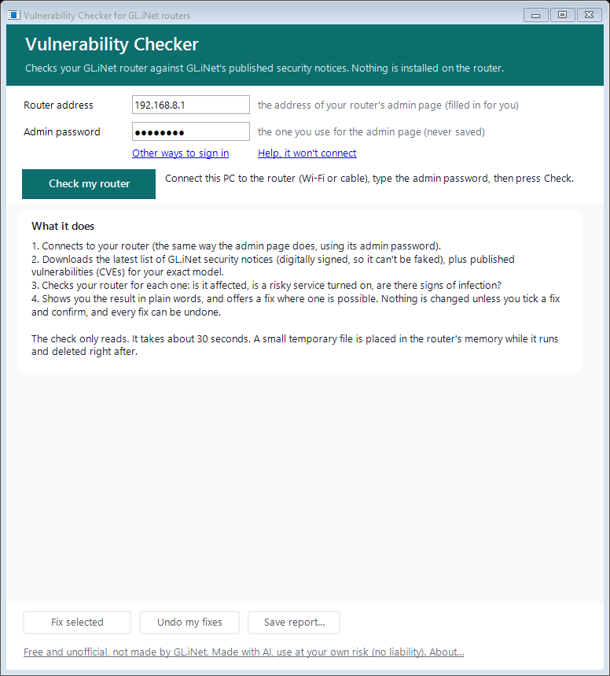
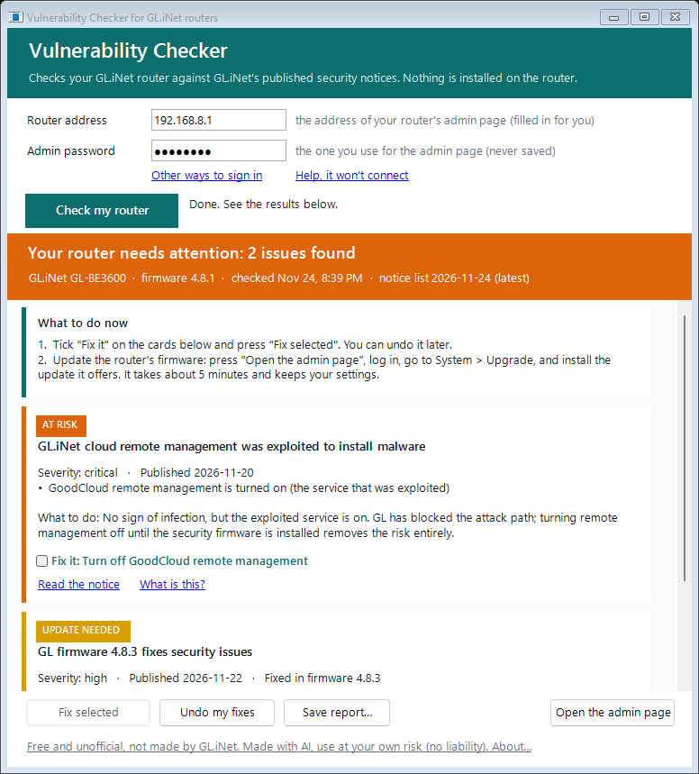

# Vulnerability Checker for GL.iNet routers (Windows)

**Is your GL.iNet router affected by the latest security problems, or was it already hacked?** This free program checks it for you in about 30 seconds. It's one file, a normal Windows window, and you don't need to know anything about routers.

**[Download Vulnerability-Checker.exe](Vulnerability-Checker.exe)** (on the next page, click the download button ⤓), then double-click it.

It's a separate program: you **don't** need Router Home installed, and it installs nothing on your router.

> [!WARNING]
> **Made with AI, use at your own risk.** This program was written with the help of AI (Anthropic's Claude). It's a free hobby project, not made, endorsed or supported by GL.iNet, provided "as is" with **no liability for any problems** it may cause. It can only find problems that have been published, so "nothing found" is not a guarantee.

## How to use it

1. **Connect your PC to the router** (its Wi-Fi or a cable).
2. **Run `Vulnerability-Checker.exe`.** The router's address is filled in for you.
3. **Type the router's admin password**, the one you use for its admin page.
4. Press **Check my router**.
5. Read the result. The **What to do now** card tells you the next steps in plain words.

*Example results for a made-up router: one risky setting with a fix, and a firmware update.*

## What it checks

- **GL.iNet's published security notices.** These are kept in a digitally signed list that's downloaded fresh every time, so new notices reach you without downloading a new version. The signature means nobody can slip in fake checks.
- **Signs of an actual attack**, wherever they've been published: backdoor programs, changed startup files, attacker SSH keys, connections to attackers' servers. So it can tell "you could be attacked" apart from "you were attacked".
- **Brand-new GL notices** that aren't in the list yet. You see them with a link to read.
- **Your firmware:** whether GL's newest firmware for your model fixes security problems.
- **Published vulnerabilities (CVEs)** for your exact model, from the US National Vulnerability Database.
- **General signs of a break-in:** programs running from temporary folders, extra admin accounts, and similar.

## What you'll see

| Result | Meaning |
|---|---|
| **SAFE** | Checked, nothing found |
| **UPDATE NEEDED** | Your firmware is older than GL's fix. Install the update from the admin page. |
| **AT RISK** | A risky setting is on. Usually you can tick **Fix it** to turn it off (and undo it later). |
| **SUSPICIOUS / UNUSUAL** | Something matches a sign of trouble, but isn't proof |
| **DANGER** | Signs that the router was hacked. **How to clean the router** walks you through it. |
| **NEW NOTICE** | GL posted something the list can't check yet. Read it. |

## Good to know

- **Everything is inside the .exe.** No zip, nothing to install. Works on Windows 10 and 11.
- **It only looks, unless you ask.** It reads settings and running programs. Nothing changes unless you tick a fix and confirm, and setting fixes can be undone with **Undo my fixes**.
- **Your password stays on your PC.** It goes straight to Windows' own SSH program for this one connection and is never saved.
- **Nothing is installed on the router.** A small script runs once in the router's memory and is deleted straight away.
- **"Windows protected your PC"?** This free program isn't code-signed, so Windows asks once. Click **More info → Run anyway**.
- **Antivirus:** scanned on VirusTotal (together with the rest of the repo) and with Malwarebytes on November 25, 2026: Malwarebytes clean, and 1 detection from a smaller engine out of about 60 for the whole repo. Report links and details: [Antivirus scans](../README.md#antivirus-scans-virustotal). The full code is in the [Source code](../Source%20code/Vulnerability%20Checker) folder.
- **Can't connect?** The program works out why and tells you what to do. Usually it's one setting to switch on in the admin page (it opens the page for you).
- **Save report** makes a text file you can share when asking for help. IP and MAC addresses are removed automatically.
- **Think your router was hacked?** Don't restart it first: a restart erases evidence. Run the check, save the report, then follow **How to clean the router**.

## For advanced users

- **SSH keys:** "Other ways to sign in" lets you use your SSH key file, or make a key for this PC so you don't need the password next time.
- **What runs on the router:** the router itself downloads the list and checks its signature with OpenWrt's `usign`. If that fails, the copy built into the program is used. The list's format and every check are described in the [security folder](../security/README.md).
- **Undo scripts** for fixes are kept on the router in `/root/vulnchecker/`.

Want continuous monitoring with alerts instead of a one-time check? That's [Router Home](../README.md).
Found a problem? [Report it](../README.md#found-a-bug-or-an-issue).
